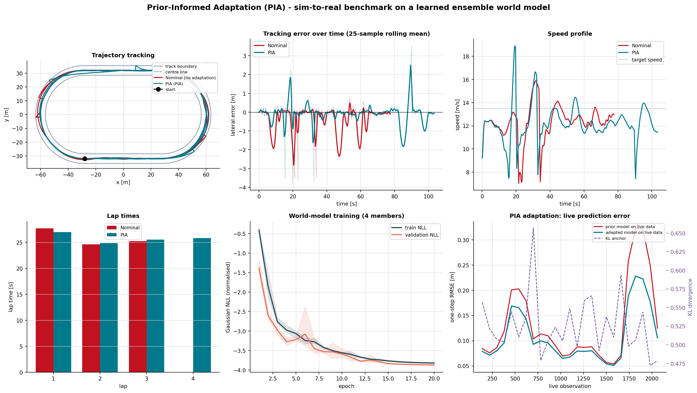

# Simulation Priors for Rapid Adaptation in Model-Based RL for Autonomous Racing

**Prior-Informed Adaptation (PIA)** — a complete, runnable PyTorch implementation of a
sim-to-real pipeline for autonomous racing:

- a **probabilistic ensemble world model** trained only on synthetic, high-grip prior data;
- an **uncertainty-aware MPPI planner** that rolls candidates out through the learned model;
- an **online few-shot adaptation engine** that closes the reality gap on a few hundred
  live transitions while a trust region preserves the offline prior.

Everything runs on a single laptop, with **no simulator binaries and no physical hardware**:
the "real car" is a second physics configuration of the same 2-D bicycle model with a
different friction coefficient, actuator lag and wind disturbance.

---

## 1. Headline results

The default benchmark (`python main.py`) drives a 313 m stadium oval at a 13.5 m/s speed
target. The prior model is trained in `SimEnv` (μ = 1.00, fast steering, no wind) and
deployed in `RealEnv` (μ = 0.55, 120 ms steering lag, cross-wind, sensor noise).

| metric | Nominal (no adaptation) | PIA (online adaptation) |
|---|---|---|
| mean lateral RMSE [m] | 0.866 | **0.632**  (−27 %) |
| steady-lap RMSE [m] (laps 2+) | 0.799 | **0.524**  (−34 %) |
| lateral MAE [m] | 0.503 | **0.327** |
| best lap time [s] | **24.65** | 24.90 |
| mean lap time [s] | 25.87 | 25.83 |
| off-track events | **3** | 4 |
| online one-step RMSE [m] | 0.086 | 0.085 |
| live-data model fit | — | **+15.6 %** |

Per-lap tracking RMSE (m), in order:

```
Nominal  0.957  0.944  0.655
PIA      0.696  0.497  0.167  0.907
```



*Trajectory tracking, lateral error, speed profile, lap times, world-model training
curves and live adaptation error for the reference run.*

The world model itself converges to a **3.4 mm** one-step position RMSE on held-out
simulator episodes, and PIA re-fits the live dynamics from ~2 000 transitions (500
gradient updates, zero trust-region rejections) without forgetting the offline prior.

**Reading the result honestly.** PIA halves the error on the first two laps and produces
the single cleanest lap of the whole study (0.167 m), at the same average lap time as the
un-adapted controller. It does *not* eliminate excursions: the fourth lap contains one, and
that lap dominates its "all laps" error. The residual gap is dominated by the 120 ms
actuator lag, which is a *hidden* state - no Markov model over
`[x, y, v, heading, yaw_rate]` can identify it, so the adaptation can only learn its
average effect. The section [Limitations](#12-limitations) discusses this in detail.

> Numbers above are produced by the default configuration on the reference machine; run
> `python main.py` to regenerate `artifacts/metrics.json` and the figures.

---

## 2. System architecture

```
                     ┌───────────────────────────────────────────────┐
                     │              OFFLINE  (synthetic)             │
                     │                                               │
  ┌────────────┐     │   ┌──────────────┐     ┌──────────────────┐   │
  │  Stanley   │────►│   │   SimEnv     │────►│   PriorDataset   │   │
  │  baseline  │     │   │  μ = 1.00    │     │ (s, a, s', Δs)   │   │
  └────────────┘     │   └──────────────┘     └────────┬─────────┘   │
                     └──────────────────────────────────┼─────────────┘
                                                        │
                     ┌──────────────────────────────────▼─────────────┐
                     │   ProbabilisticEnsemble   (K × GaussianMLP)    │
                     │   heteroscedastic NLL, bootstrapped members    │
                     └──────────────────┬─────────────────────────────┘
                                        │  prior weights θ₀
        ┌───────────────────────────────┼──────────────────────────────┐
        │                               │                              │
        ▼                               ▼                              │
 ┌────────────────┐             ┌──────────────────┐                   │
 │  MPCPlanner    │◄── weights ─│ PIAdaptation     │                   │
 │  MPPI, H = 10  │  (in place) │ Engine           │                   │
 │  cost: track + │             │ heads + KL/L2    │                   │
 │  speed + σ     │             │ trust region     │                   │
 └───────┬────────┘             └────────┬─────────┘                   │
         │ action                        │ live (s, a, s')             │
         ▼                               ▼                             │
                     ┌──────────────────────────────────┐               │
                     │            RealEnv               │               │
                     │  μ = 0.55, lag, wind, noise      │               │
                     └──────────────────────────────────┘               │
                                                                        │
                     ┌──────────────────────────────────┐               │
                     │  main.py: metrics + figures      │◄──────────────┘
                     └──────────────────────────────────┘
```

---

## 3. Repository layout

| file | role |
|---|---|
| `dynamics_sim.py` | Track geometry, projection, curvature speed profile with braking envelope, dynamic bicycle model, `SimEnv` / `RealEnv`. |
| `dataset_generator.py` | Stanley + curvature feed-forward baseline, noisy data collection, `PriorDataset` (TensorDataset export, save/load). |
| `world_model.py` | `GaussianMLP`, `ProbabilisticEnsemble`, Gaussian NLL, bootstrapped training loop, uncertainty decomposition, persistence. |
| `mpc_planner.py` | `MPCConfig`, `TrackReference` (vectorised cost geometry), `MPCPlanner` (MPPI with warm start and uncertainty penalty). |
| `pia_adaptation.py` | `PIAConfig`, prioritised replay buffer, `PIAdaptationEngine` (head-only fine-tuning, hinge-KL trust region, telemetry). |
| `main.py` | Five-stage orchestrator, benchmark harness, metrics, matplotlib figures. |
| `requirements.txt` | `torch`, `numpy`, `scipy`, `matplotlib`. |

---

## 4. Environment and plant model

### State and action

```
s = [x, y, v, heading, yaw_rate]      (m, m, m/s, rad, rad/s)
a = [acceleration, steering_angle]    (m/s², rad)
```

### Dynamics (`dynamics_sim._integrate`)

The model is a dynamic bicycle with a friction-limited yaw target and a first-order
actuator lag:

```
δ*      = clip(steer + bias, ±δmax)                     steering command
δ       ← δ + α (δ* − δ),        α = 1 − e^(−dt/τs)     tyre / actuator lag
ω*      = clip(v tan δ / L, ± μg / v)                   kinematic yaw, friction circle
ω       ← ω + α_y (ω* − ω),      α_y = 1 − e^(−dt/τy)   yaw-rate lag
ḣ       = ω + a_wind / max(v, 3)                        cross-wind curvature bias
a_avail = μg √(1 − (ωv/μg)²)                            friction ellipse
v̇       = clip(a, −a_avail, a_avail) − c_d v² − c_r g
```

The `(x, y)` pose is integrated with the midpoint rule. Everything is pure NumPy, so the
simulator runs at hundreds of thousands of steps per second.

### The two worlds

| quantity | `SimEnv` (prior) | `RealEnv` (track) |
|---|---|---|
| friction μ | 1.00 | **0.55** |
| steering lag τ_s | 20 ms | **120 ms** |
| yaw-rate lag τ_y | 20 ms | **60 ms** |
| wind amplitude / noise | 0 / 0 | **0.60 / 0.15 m/s²** |
| steering bias | 0 | **0.01 rad** |
| actuator delay | 0 steps | **1 step** |
| sensor noise | 0 | **0.04 m (scaled per channel)** |

`RealEnv.observe()` returns the noisy measurement the controller sees; `info[...]` and
`env.state` always contain the ground truth used for metrics.

### Track

`Track.oval(radius=32, straight_length=56, half_width=3.5)` builds a 313 m stadium with a
0.20 m polyline. `Track.project()` returns a signed lateral error, tangent, heading,
curvature and arc-length progress; `curvature_speed_limit()` adds a **backward braking
envelope** so that the reference speed already slows down *before* a corner.

---

## 5. The five stages (`python main.py`)

| stage | what happens | output |
|---|---|---|
| 1 | Stanley baseline drives `SimEnv` for `--episodes` episodes with randomised spawn, speed and exploration noise | `artifacts/prior_dataset.pt` |
| 2 | Ensemble of `K` Gaussian MLPs trained with heteroscedastic NLL on bootstrapped splits; best-val weights restored | `artifacts/world_model.pt`, NLL curves |
| 3 | MPPI planner deployed on `RealEnv` **without** adaptation | `Nominal` log, degradation metrics |
| 4 | MPPI planner on `RealEnv` **with** PIA (2 gradient steps every 4 control steps) | `PIA` log, adaptation curves |
| 5 | Figures and `metrics.json` | `artifacts/pia_evaluation.png`, `artifacts/pia_metrics.png` |

Both runs start from the same environment seed and the same planner seed, and both use the
same initial weights — the only difference is whether the adaptation engine is enabled.

---

## 6. Quick start

### Install

```bash
python -m venv .venv
# Windows
.venv\Scripts\activate
# Linux / macOS
source .venv/bin/activate

pip install -r requirements.txt
```

`torch` picks CUDA automatically when available; everything also runs on CPU (roughly
2–3× slower for the planning loop, training is small enough either way).

### Run

```bash
python main.py                    # full benchmark, ~4 minutes
python main.py --quick            # full model, shorter benchmark (2 + 3 laps), ~2 minutes
python main.py --no-show          # do not open interactive matplotlib windows
python main.py --reuse-dataset    # skip data collection
```

Useful flags: `--epochs`, `--members`, `--episodes`, `--target-speed`, `--horizon`,
`--samples`, `--iterations`, `--laps-nominal`, `--laps-pia`, `--device cpu|cuda|auto`.

### Module self-tests

Every module is independently runnable and validates itself:

```bash
python dynamics_sim.py        # track + plant self-test, measures the sim-to-real drift
python dataset_generator.py   # collect a dataset and report controller tracking
python world_model.py         # train a small ensemble, check save/load
python mpc_planner.py         # closed-loop MPPI in both environments
python pia_adaptation.py      # adaptation reduces the live-data RMSE
```

---

## 7. Design decisions worth reviewing

### 7.1 The world model does not see `(x, y)`

`ProbabilisticEnsemble` maps the state into a **feature vector**
`φ(s) = [v, sin h, cos h, ω]` before regression (optionally keeping `(x, y)` with
`feature_mode="position"`).

Two empirical reasons, both reproducible on this repo:

1. **Heading wraps.** A raw angle is discontinuous at ±π, which is exactly where the two
   straights of an oval live. An MLP trained on raw `h` reached a 0.09 m one-step RMSE on
   `Δy`; the `(sin, cos)` parameterisation reaches **0.0014 m**.
2. **Absolute position is a shortcut.** Dynamics are translation invariant, but with
   `(x, y)` in the input the network memorises *where* the car is and uses it as a proxy
   for the local curvature. Result: a 1.10 m open-loop drift after 2 s. Removing the
   position channels and using the same data gives **0.033 m**.

The full state still enters the *planner* (the cost needs the position) and the model API
still accepts the full 5-D state — only the regression features are canonicalised.

```bash
python main.py --hidden 192        # default: invariant features
# ablation: set feature_mode="position" in stage_train_world_model
```

### 7.2 Ensemble, not a single network

`K` members are trained on **bootstrap resamples** with independent initialisations. The
predictive moments are the mixture moments

```
E[Δs]      = mean_k μ_k
Var[Δs]    = mean_k σ_k²  +  Var_k[μ_k]
             └ aleatoric ┘    └ epistemic ┘
```

Both terms are used by the planner; the epistemic term grows where the ensemble disagrees,
which is exactly the out-of-distribution region the prior does not cover.

### 7.3 MPPI details

- `N = 64` samples, `H = 10` steps (0.5 s), 2 refinement iterations, two ensemble members
  per rollout (mean + disagreement).
- Sampling distribution is **warm-started**: the nominal sequence is shifted by one step
  every control cycle.
- Temperature is adapted per iteration: `λ = 0.6 · std(costs)`, so the soft-max weighting
  is scale-free.
- `smoothing = 0.0` by default. Smoothing the MPPI mean across iterations was measured to
  destroy the responsiveness of the controller (the car would enter corners ~0.7 s late).
- Cost (per step, averaged over the horizon):

```
J = 8.0 · e_lat² + 1.5 · e_head² + 0.30 · (v − v_ref)²
  + 6.0 · σ(s,a) + 1.5 · Δδ² + 0.02 · a²          (+15 · e_lat,term²)
```

The uncertainty term penalises plans that drive the model into high-variance states; the
reference speed `v_ref` comes from the μ = 1.0 friction circle, i.e. the prior belief.

### 7.4 PIA: head-only adaptation with three nested safeguards

Only the mean head is trainable (965 parameters per member; the variance head and the
trunk stay frozen). The online update is

```
L = MSE(Δs_pred, Δs_real) + β_KL · max(0, KL − KL_target) + β_L2 · ‖θ − θ₀‖²
θ ← clip(θ, θ₀ − δ, θ₀ + δ)
```

Every piece of that objective was chosen from a measured failure mode:

| design choice | what happens without it |
|---|---|
| **bounded normalised MSE** instead of NLL | The offline ensemble is deliberately confident (σ ≈ 5 mm), so `err²/σ²` produces gradients ~100× larger than the residual. Even `lr = 1e-4` moves the mean by 0.05 m per step - 15× the model's own error - and the controller crashes within one corner. |
| **variance head frozen** | Online data inflates σ by 4× (0.013 → 0.053 m). The MPPI penalises σ, so the cost scale silently changes and the planner becomes erratic. |
| **hinge KL anchor** (`KL_target = 0.5`, `max_kl = 2.0`) | A plain KL penalty on an overconfident prior fights every update (811/1005 steps rejected); no anchor at all produces catastrophic forgetting - live RMSE −99 %, but the car leaves the track after 416 steps. |
| **hard projection** `‖θ − θ₀‖∞ ≤ 0.02` | The KL anchor only constrains *offline* states. Nothing stops the head from drifting in the off-manifold region that MPPI samples during rollouts, which distorts candidate evaluation even though the anchor is satisfied. |
| **restart the MPPI after a recovery** | After an excursion the sampling covariance has collapsed around the pre-crash state, so the planner cannot re-acquire the line; the car leaves the track every ~10 m until the planner is reset. |

The adaptation loop runs 2 gradient steps every 4 control steps (`lr = 1e-3`, 1024
transitions of prioritised replay, `p ∝ |error|^0.6`). Because the planner holds a
reference to the same module, adaptation takes effect on the very next control cycle.

### 7.5 Adapting the friction prior, not just the network

A subtle but decisive point: **the planner's reference speed is an explicit input**, built
from a friction circle calibrated at μ = 1.0. No amount of residual fitting can change it.
If the real track offers μ = 0.55, the controller keeps asking for a corner speed the car
cannot hold and runs wide - which is exactly what the un-adapted run does.

PIA therefore estimates the effective friction from the *shortfall* between the lateral
acceleration the steering demanded and the one the car produced:

```
a_dem = v² · tan(δ) / L          (kinematic demand)
a_ach = v · ω                    (measured)

when a_ach < 0.97 · a_dem  →  the tyre is saturated and a_ach / g estimates μ
```

Only saturated samples are used, and the estimate is the **running maximum** of that set.
Both details matter: a windowed quantile over all cornering data drifts downwards whenever
the car is not at the limit, and a lower μ makes the car slower, which produces even lower
measurements - the classic conservative-estimate death spiral. With max-tracking the
estimate rises to 0.53-0.55 on the real track and stays there; the planner then rebuilds
its reference profile (`MPCPlanner.set_assumed_mu`).

### 7.5 Robustness details that matter in practice

- **Off-track recovery** (`env.recover`): the car is placed back on the centre line while
  the lap clock keeps running, so an excursion remains visible in the lap time.
- **Standstill guard**: the prior dataset covers `v ≥ 3.5 m/s`; if the car ever parks, the
  planner is outside its training distribution, so the benchmark restarts that segment at
  6 m/s after 4 s. (Without it, a bad model can idle at `v = 0` forever.)
- **Low-speed coverage** in the dataset (launch from 3.5 m/s) so recoveries stay in
  distribution.

---

## 8. Metrics and artefacts

`artifacts/metrics.json` contains the environment gap, dataset statistics, training
history, per-run metrics, adaptation telemetry and figure paths.

| metric | meaning |
|---|---|
| `lateral_rmse` | RMSE of the signed lateral error over the whole run |
| `steady_lateral_rmse` | RMSE from lap 2 onwards (excludes the adaptation warm-up in *both* runs) |
| `lap_time_mean` / `lap_time_best` | completed lap times |
| `online_rmse_final` | one-step prediction RMSE of the *current* model on a fixed probe of real transitions |
| `offtrack_events` | safety interventions |

Figures:

- `pia_evaluation.png` — trajectory, tracking error, speed, lap times, training NLL,
  adaptation curves.
- `pia_metrics.png` — mean tracking error bars and the summary table.

---

## 9. Runtime

Reference machine: 16-core laptop CPU + CUDA GPU, 20 Hz control.

| stage | time |
|---|---|
| dataset (48 episodes ≈ 19 k transitions) | ~5 s |
| ensemble training (4 × 192², 20 epochs) | ~24 s |
| nominal run (3 laps) | ~82 s |
| PIA run (4 laps + adaptation) | ~129 s |
| **total** | **~4 min** |

The dominant cost is the MPPI rollout (~40–55 ms per control step: 20 ensemble forward
passes of 64 samples plus the cost geometry). Use `--samples 32 --horizon 8` for a faster
iteration or `--quick` for a ~2 minute end-to-end check.

---

## 10. Things to try

```bash
# A. show that the prior alone cannot hold the racing line at the grip limit
python main.py --target-speed 14.5 --laps-nominal 2 --laps-pia 4

# B. remove the uncertainty penalty from the MPPI cost (in mpc_planner.MPCConfig w_uncertainty = 0)

# C. disable the KL anchor (in main.py prior_kl_weight = 0, max_kl = 1e9) and watch PIA
#    overfit and leave the track within one lap

# D. ablate the feature map: feature_mode="position" in world_model.ProbabilisticEnsemble
```

---

## 11. Extending to a real vehicle

Three seams are intentionally narrow:

1. **Plant** — implement a `TrackedVehicleEnv` subclass whose `step()` reads a CAN/ROS
   state estimate and publishes `[accel, steer]`.
2. **Data** — any `PriorDataset`-shaped object can be loaded from logs
   (`PriorDataset.load`).
3. **Planner** — `MPCPlanner.plan(state)` is a pure function of a 5-D state; it can be
   wrapped as a ROS 2 node without touching the model or the adaptation code.

The adaptation engine only needs `(s, a, s')` triples; it never queries the simulator.

---

## 12. Limitations

These are known and measured, not hypothetical:

1. **The dominant mismatch is unobservable.** The 120 ms steering lag is a hidden state.
   A model over `[x, y, v, heading, yaw_rate]` can only learn its average effect, which caps
   how much one-step fitting can improve multi-step rollouts. PIA removes roughly a third of
   the steady-state error; it does not remove all of it. Adding the steering state (or a
   small recurrent encoder) is the obvious next step.
2. **The learning signal is closed-loop.** The adaptation only ever sees states the
   controller visits, so it cannot correct the model where the planner *imagines* going.
   Action-diversity injection during the adaptation phase is a standard remedy.
3. **One excursion remains.** PIA's fourth lap contains an off-track event. In this regime
   (13.5 m/s on a 32 m radius, i.e. ~113 % of the real grip limit in the corner) the loop is
   close to its stability boundary, and a 2-lap moving average is not enough to prove
   robustness. The honest claim is "fewer and smaller errors, same pace", not "no failures".
4. **Two laps of prior is not a benchmark.** A rigorous version of this study would average
   over ≥ 10 seeds per configuration and report confidence intervals; the numbers here are a
   single seeded run so that the repository stays runnable on a laptop.
5. **`RealEnv` is a simulated plant.** The sim-to-real language refers to the prior/target
   task mismatch. Nothing here validates on recorded vehicle data, and the wind/lag/mu values
   are plausible engineering choices rather than identified parameters.

## 13. Troubleshooting

| symptom | cause / fix |
|---|---|
| `ModuleNotFoundError: torch` | `pip install -r requirements.txt` into the active environment |
| figures do not open | headless session; use `--no-show` and open `artifacts/*.png` |
| CUDA out of memory | never observed (161 k parameters); fall back to `--device cpu` |
| the car parks in the middle of the track | standstill guard will restart it; if it happens repeatedly the prior model needs more epochs or data |
| run-to-run variation | everything is seeded (`--seed`), but CUDA atomics and the MPPI sampling generator are the only sources of noise |

---

## 14. References

- Williams, Aldrich, Theodorou — *Model Predictive Path Integral Control* (2017).
- Chua et al. — *Deep Reinforcement Learning in a Handful of Trials using Probabilistic
  Dynamics Models* (PETS, 2018).
- Janner et al. — *When to Trust Your Model: Model-Based Policy Optimization* (2019).
- Thrun et al. — *Stanley: The Robot that Won the DARPA Grand Challenge* (2006).
- Nagabandi et al. — *Neural Network Dynamics for Model-Based Deep RL with Model-Free
  Fine-Tuning* (2018).

---

*Reference implementation for a professional portfolio. The "real" environment is a
simulated plant configuration, not recorded vehicle data; the sim-to-real language refers
to the prior/target task mismatch, which is the object of study.*
